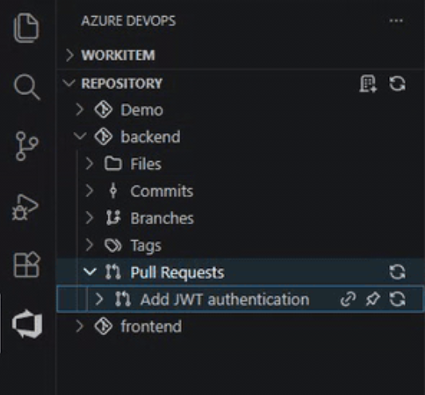
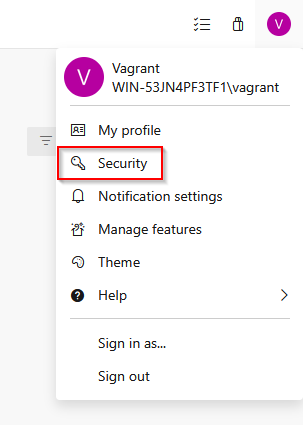

# Toolbox for Azure DevOps

This extension provides convenient access to Microsoft Azure DevOps from within Visual Studio Code and similar code editors. Perform common Azure DevOps tasks without leaving your IDE.

**Note**: This is a third-party project with no affiliation to Microsoft.

## Getting Started

After installing the extension:

1. Click **Add Organization** in any of the Azure DevOps views
2. Enter your server address (defaults to `https://dev.azure.com/`). You can also paste the full URL of your organization, e.g. `https://dev.azure.com/my-organization`, then the next step is skipped.
3. Enter your organization name
4. Choose how to sign in (only for Azure DevOps Cloud, see below)

The extension then tests the connection. If it fails, you can still save the organization and fix the credentials later. More information on sign-in methods [below](#sign-in-methods).

## Tree Views

The extension provides four views into your Azure DevOps data.

### Work Items

- Work items assigned to you and your teams
- Saved queries, area paths, and work item hierarchy
- Work item details: comments, history, and attachments
- Linked items: commits, pull requests, branches, builds, and related work items
- Edit work items: change state, title, effort, and assignee

### Repositories

- Repository files, commits, branches, and tags
- Pull requests with reviewers, statuses, comments, and linked work items
- Open files in the editor or in the Azure DevOps web portal

### Pipelines

- Pipeline folders, pipelines, and runs
- Run artifacts and timeline records
- Create, rename, and delete folders
- Run, cancel, and re-run pipelines
- Rename and delete pipelines

### Agents

- Agent pools and individual agents
- Jobs running on agents

## Common Actions

Some tree items support:

- **Pin/Unpin**: Keep frequently accessed items at the top of their tree
- **Open in Web**: View items in the Azure DevOps web portal
- **Refresh**: Manually refresh tree data (configurable auto-refresh is also available)

## Configuration

Extension settings (Ctrl+, → Extensions → Azure DevOps Toolbox):

- **Auto-refresh interval**: How often to automatically refresh tree data (in milliseconds)
- **Unwrap accounts**: Show account items directly when only one account exists
- **Unwrap projects**: Show project items directly when only one project exists per account

## Requirements

Tested with:

- Azure DevOps (Cloud)
- Azure DevOps Server Express (Local)

Should also work with:

- Azure DevOps Server (Local)
- Team Foundation Server (TFS)

## Sign-in Methods

Each organization has its own sign-in method:

- **Microsoft Account**: Sign in with your Microsoft (Entra ID) account through VS Code's built-in Microsoft authentication. Only suggested and available for Azure DevOps Cloud (`https://dev.azure.com/…` and `https://*.visualstudio.com/…`).
- **Personal Access Token (PAT)**: Works with Azure DevOps Cloud, Azure DevOps Server and TFS.

### Microsoft Account

With a Microsoft account, the extension never asks you to sign in on startup. If VS Code has no session for the account, the organization is shown as **Signed out**. Click it, or use **Sign In**, to sign in again. VS Code also offers the sign-in in its Accounts menu.

If several Microsoft accounts are signed in to VS Code, you are asked which one to use. The tenant of the organization is detected automatically. If that fails, you are asked for a tenant ID; leave it empty to use the home tenant of your account.

### Creating a Personal Access Token

In Azure DevOps, click your user icon in the top right corner → **Security** → **Personal access tokens** → **New Token**. Grant appropriate scopes and use the token when adding your organization. Tokens expire and must be renewed with **Update Credentials**.

### Managing Organizations

Right-click an organization for:

- **Update Credentials**: Enter a new PAT, or sign in to your Microsoft account again. Also offered on items that failed with an authentication error.
- **Change Sign-in Method**: Switch between Microsoft account and PAT. A stored PAT is deleted when you switch to a Microsoft account.
- **Remove Organization**: Removes the organization together with its credentials and pinned items. Your Microsoft session in VS Code is left alone.

## Contributing

Report issues or request features on [GitHub](https://github.com/berndfuhrmann/toolbox-azure-devops).

For code contributions, see `CONTRIBUTING.md`.
